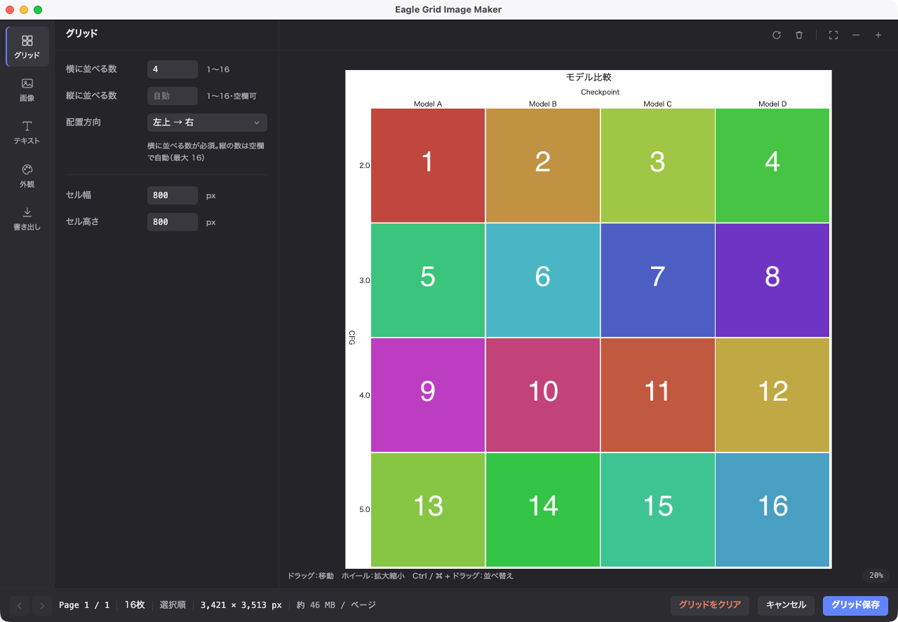
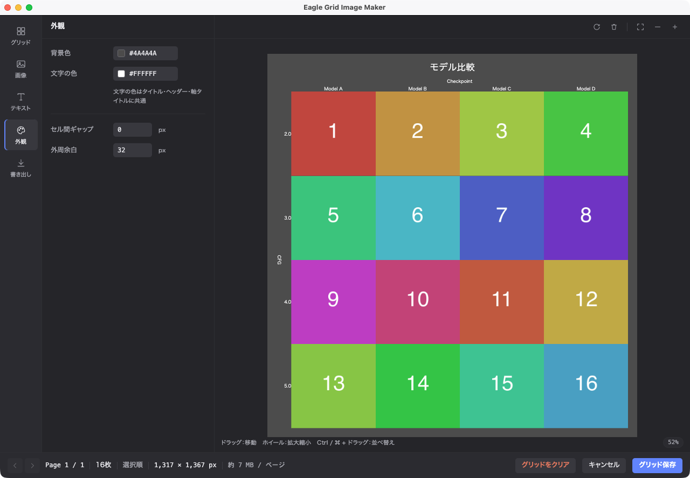
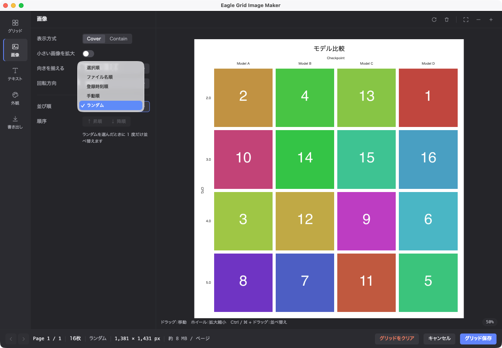
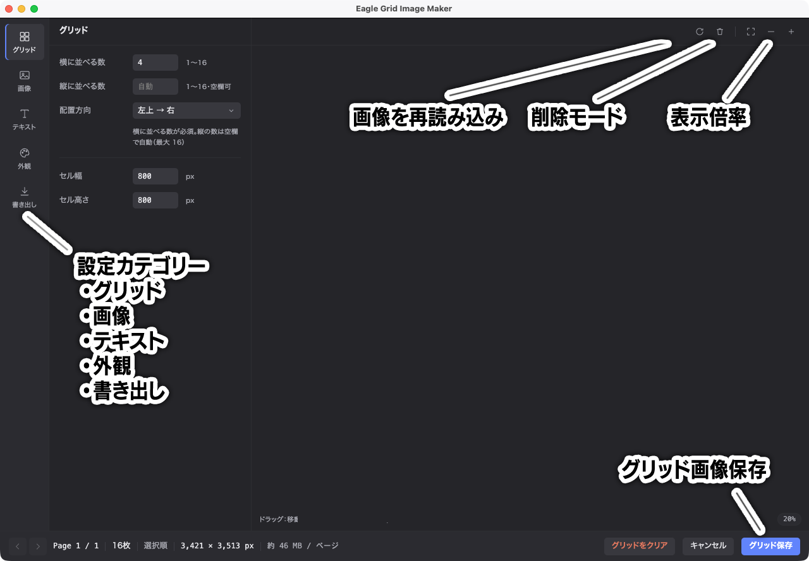

<figure style="margin-bottom:2rem">
  
</figure>

# Eagle Grid Image Maker

[English](README.md) | 日本語

画像管理アプリ [Eagle](https://eagle.cool/) のプラグインです。Eagle で選んだ画像を格子状に並べて、1枚のグリッド画像として書き出します。

- 画像を並べただけのコンタクトシート
- 行と列に見出しを付けて比べる XY プロット（画像生成の設定の比較などに）

## 主な特徴

- セルの大きさ・間隔・外側の余白・背景色を指定可能
- 画像の縦長・横長を自動で揃えることが可能
- 並び順を選べる：選択順・ファイル名順・登録時刻順・手動・ランダム
- 画像を `Ctrl / ⌘ + ドラッグ` すると、画像を好きな位置に移動できる
- タイトルや、列ごと・行ごとの見出しと、横軸・縦軸のタイトルを付けられる
- 不要な画像を選択して除外できる
- 1ページに収まらない画像は、連番を付けた複数のページに分割可能

<figure style="margin-bottom:2rem">
  
  <figcaption>▲セル間の余白、文字色、背景色などを調整可能</figcaption>
</figure>
<figure style="margin-bottom:2rem">
  
  <figcaption>▲任意のセルを <code>Ctrl / ⌘ + ドラッグ</code> でドラッグ移動したり、ランダム順も対応</figcaption>
</figure>

## 動作環境

- Eagle 4.0
- macOS（Apple Silicon）または Windows（x64）

### 制限事項

- 1ページは最大 16 列 × 16 行まで
- 最大 32 ページ（8,192 枚）
- Intel の Mac と、ARM 版の Windows には対応していません。
- 書き出しサイズ上限：
  - JPEG：幅・高さとも 65,500 px まで
  - WebP：幅・高さとも 16,383 px まで

## インストール

1. [Releases](https://github.com/da2el-ai/eagle-grid-image-maker/releases) から、お使いの OS に合った `.eagleplugin` をダウンロードします
   - macOS（Apple Silicon）：`…-mac-arm.eagleplugin`
   - Windows（x64）：`…-win-x64.eagleplugin`
2. ダウンロードしたファイルをダブルクリックして、Eagle に追加します

## 使い方

1. Eagle でグリッドにしたい画像を選びます
2. Eagle の「プラグイン」から「Eagle Grid Image Maker」を開きます。選んでいた画像が読み込まれます
3. 左のアイコンで設定の種類を選び、中央で設定を変えます。右のプレビューにすぐ反映されます
4. 右下の「グリッド保存」を押して、保存先とファイル名を選びます

<figure style="margin-bottom:2rem">
  
  <figcaption>▲左側のアイコンから設定カテゴリーを選ぶ</figcaption>
</figure>

### 設定の種類

| 種類 | 設定できること |
|---|---|
| グリッド | 横に並べる数・縦に並べる数・配置方向（左上から右へ／下へ）・セルの幅と高さ |
| 画像 | 表示方式（Cover / Contain）・小さい画像の拡大・向きを揃える・並び順 |
| テキスト | タイトル・XY プロット（軸のタイトル、列と行の見出し）・フォントと文字の大きさ |
| 外観 | 背景色・文字の色・セルの間隔・外側の余白 |
| 書き出し | 形式（JPEG / PNG / WebP）・品質 |

### プレビューの操作

| 操作 | 動き |
|---|---|
| ドラッグ | 表示を動かす |
| ホイール | 拡大・縮小 |
| Ctrl / ⌘ + ドラッグ | 画像を好きな位置に移す（並び順は「手動」になります） |
| 右上のゴミ箱を押してから画像を押す | その画像をグリッドから外す（Eagle からは消えません） |
| 右上の再読み込み | Eagle で今選んでいる画像を足す |

- プレビューには Eagle のサムネイルを使っています。拡大するとぼやけますが、書き出す画像は元の画像から作るので、ぼやけません
- 右下に、書き出す画像の大きさ（px）と、1ページあたりのおおよそのメモリの量を表示しています

## 知っておいてほしいこと

- 設定は自動で保存され、次に開いたときに戻ります
- 大きな画像を書き出すときは、時間とメモリを多く使います。目安を超えると、警告が出ます
- GIF は最初のフレームだけを使います
- 書き出しの途中で失敗したり中止したりしたときは、書き終えたページだけが残ります
- 開けない画像（壊れている・ファイルがない）があったときは、そのセルを空けて書き出し、終わったあとで一覧を出します

## ライセンス

[MIT](LICENSE)

配布する `.eagleplugin` には、次のライブラリが入っています。

- [sharp](https://github.com/lovell/sharp)（Apache-2.0）
- [libvips](https://github.com/libvips/libvips)（LGPL-3.0）と、その依存ライブラリ。ライセンスの一覧は `node_modules/sharp/vendor/` の `THIRD-PARTY-NOTICES.md` にあります
