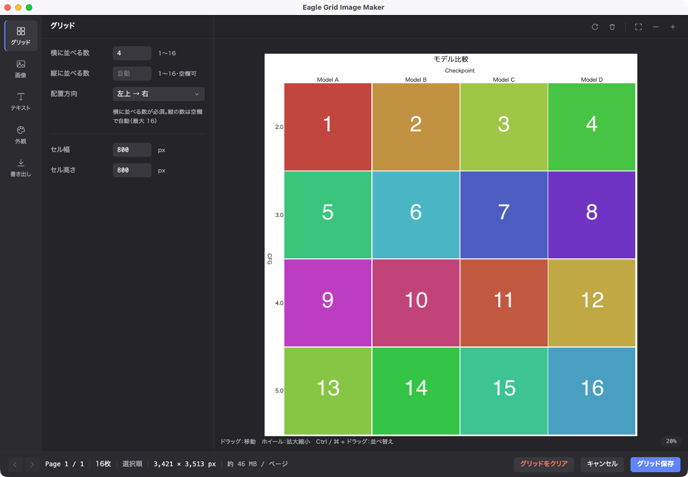
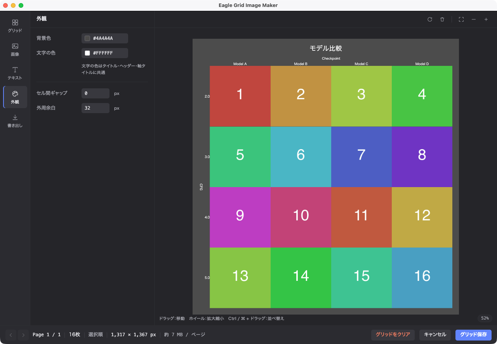
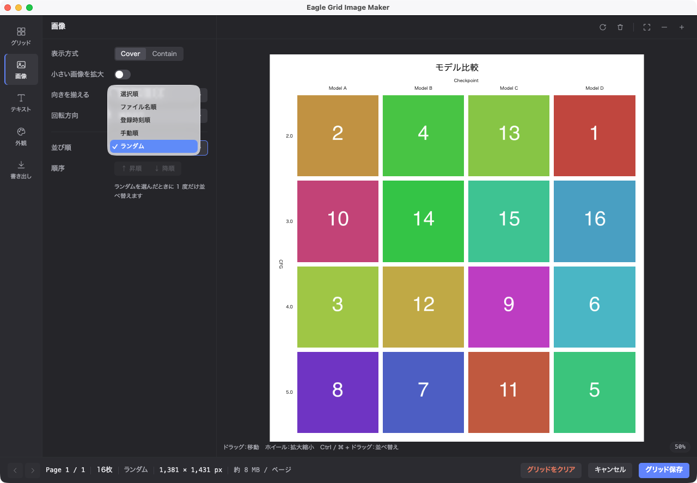
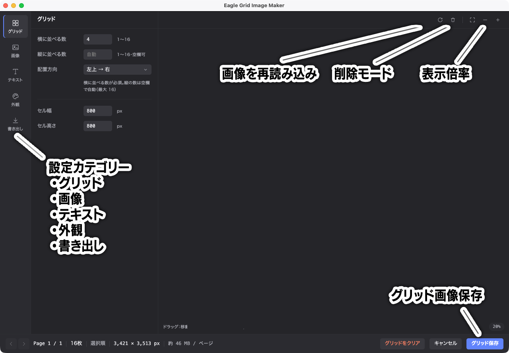

<figure style="margin-bottom:2rem">
  
</figure>

# Eagle Grid Image Maker

English | [日本語](README.ja.md)

A plugin for the image management app [Eagle](https://eagle.cool/). It arranges the images you select in Eagle into a grid and exports them as a single grid image.

- A contact sheet that simply lines up your images
- An XY plot with column and row headers for comparison (e.g. comparing image generation settings)

## Features

- Set the cell size, cell gap, outer margin and background color
- Automatically align images to portrait or landscape
- Choose the sort order: selection order, file name, date added, manual or random
- `Ctrl / ⌘ + drag` an image to move it anywhere in the grid
- Add a title, headers for each column and row, and X-axis / Y-axis titles
- Remove images you don't need
- Images that don't fit on one page are split into multiple numbered pages

<figure style="margin-bottom:2rem">
  
  <figcaption>▲ Adjust the cell gap, text color, background color and more</figcaption>
</figure>
<figure style="margin-bottom:2rem">
  
  <figcaption>▲ Move any cell with <code>Ctrl / ⌘ + drag</code>, or shuffle them in random order</figcaption>
</figure>

## Requirements

- Eagle 4.0
- macOS (Apple Silicon) or Windows (x64)

### Limitations

- Up to 16 columns × 16 rows per page
- Up to 32 pages (8,192 images)
- Intel Macs and Windows on ARM are not supported
- Maximum export size:
  - JPEG: 65,500 px in width and height
  - WebP: 16,383 px in width and height

## Installation

1. Download the `.eagleplugin` for your OS from [Releases](https://github.com/da2el-ai/eagle-grid-image-maker/releases)
   - macOS (Apple Silicon): `…-mac-arm.eagleplugin`
   - Windows (x64): `…-win-x64.eagleplugin`
2. Double-click the downloaded file to add it to Eagle

## Usage

1. Select the images you want to put in a grid in Eagle
2. Open "Eagle Grid Image Maker" from Eagle's Plugins menu. The selected images are loaded
3. Choose a settings category with the icons on the left, and change the settings in the middle. The preview on the right updates right away
4. Press "Save grid" at the bottom right, and choose a folder and file name

<figure style="margin-bottom:2rem">
  
  <figcaption>▲ Choose a settings category with the icons on the left</figcaption>
</figure>

### Settings

| Category | What you can set |
|---|---|
| Grid | Columns, rows, direction (top-left → right / down), cell width and height |
| Image | Fit (Cover / Contain), enlarge small images, align orientation, sort order |
| Text | Title, XY plot (axis titles, column and row headers), font and font size |
| Style | Background color, text color, cell gap, outer margin |
| Export | Format (JPEG / PNG / WebP), quality |

### Preview controls

| Action | Result |
|---|---|
| Drag | Pan the view |
| Wheel | Zoom in and out |
| Ctrl / ⌘ + drag | Move an image anywhere (the sort order becomes "Manual") |
| Press the trash button at the top right, then click an image | Remove that image from the grid (it is not deleted from Eagle) |
| Reload at the top right | Add the images currently selected in Eagle |

- The preview uses Eagle's thumbnails, so it gets blurry when you zoom in. The exported image is made from the original images and is not blurry
- The bottom right shows the size of the exported image (px) and the approximate memory used per page

## Good to know

- Settings are saved automatically and restored the next time you open the plugin
- Exporting large images takes a lot of time and memory. A warning appears when the size goes over a guideline
- Only the first frame of a GIF is used
- If an export fails or is stopped partway, only the pages that were finished are kept
- If some images cannot be opened (broken or missing), their cells are left empty, and a list of them is shown after the export

## License

[MIT](LICENSE)

The distributed `.eagleplugin` includes the following libraries.

- [sharp](https://github.com/lovell/sharp) (Apache-2.0)
- [libvips](https://github.com/libvips/libvips) (LGPL-3.0) and its dependencies. The list of licenses is in `THIRD-PARTY-NOTICES.md` under `node_modules/sharp/vendor/`
